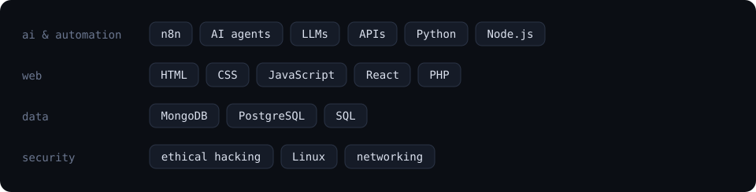

  

<h3 align="center">AI agents, workflow automation, and full-stack systems, engineered with a security mindset.</h3>

  <b>An AI assistant that runs on your phone with no internet.</b> 
  <b>A pocket device that speaks WiFi, SubGHz, BLE and IR.</b> 
  <b>Logistics software that forecasts its own costs.</b> 
  <b>Workflows that run the boring half of a business.</b>

All built. All running. The proof is one click away.

  

  

  <a href="https://zalanlykos.github.io">zalanlykos.github.io</a> &nbsp;|&nbsp;
  <a href="https://www.linkedin.com/in/zalanlykos/">LinkedIn</a> &nbsp;|&nbsp;
  <a href="https://github.com/ZalanLykos?tab=repositories">GitHub repositories</a> &nbsp;|&nbsp;
  <a href="mailto:zalanlykos@gmail.com">zalanlykos@gmail.com</a>

